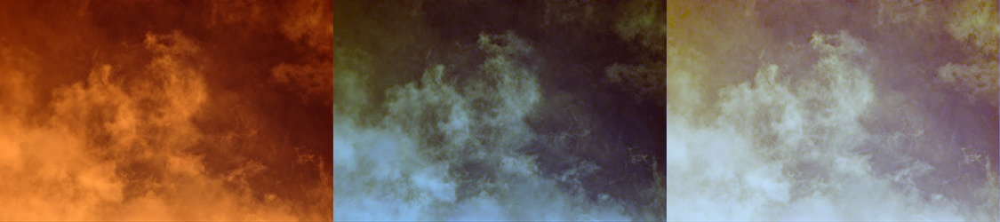

# Image White Balance & Gamma Correction

A small image-processing project that implements two classic color-correction
steps from scratch with OpenCV and NumPy:

1. **Gray-world white balance** removes color casts.
2. **Gamma correction** adjusts brightness with a power-law curve.



*Left to right: original (strong orange cast), white balanced, gamma corrected.*

## How it works

**White balance (gray-world assumption).** The average color of a scene should
be neutral gray. For each channel (B, G, R) the script computes its mean, then
scales the channel by `overall_mean / channel_mean` so that all three means are
equal. Values are clipped to [0, 255].

**Gamma correction.** Pixels are normalized to [0, 1] and transformed with
`out = in ** (1 / gamma)`, then scaled back to [0, 255]. With `gamma > 1` the
image gets brighter. With `gamma < 1` it gets darker.

## Requirements

- Python 3.8+
- `opencv-python`
- `numpy`

```bash
pip install -r requirements.txt
```

## Usage

```bash
# run on the bundled sample image
python main.py

# run on your own image with a custom gamma
python main.py path/to/photo.jpg --gamma 1.8

# also open preview windows (needs a display)
python main.py --show
```

Outputs are saved to `results/`: `original.jpg`, `balanced.jpg`, `gamma.jpg`
and a side-by-side `comparison.jpg`.

## Limitations

- The gray-world assumption fails on scenes dominated by one color. On the
  sample cloud image it can over-correct toward blue.
- Operates on 8-bit BGR images only. No sRGB linearization is done.
